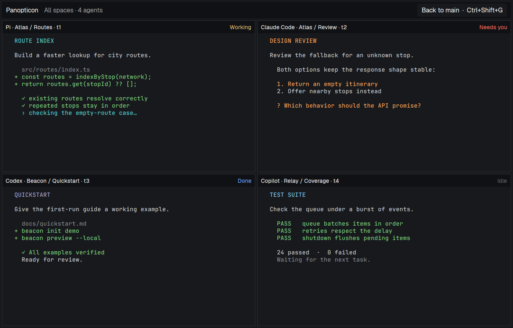

# Panopticon

Switch the entire Herdr window to an evenly spaced grid of live agent terminals, irrespective of the selected space. Find an agent by its space and tab, watch it work, type in its tile, or go back to where that agent lives.

## What you see

A 34 px toolbar says **Panopticon**, **All spaces**, and the agent count; **Back** is on the right. Below it, each tile has a 26 px caption over a live terminal. The caption shows program, space / tab, terminal address and status. The grid uses 4 px outer padding and gaps, 1 px theme-colored tile borders, the theme's chrome and foreground colors, and 12 px terminal type. With four agents there are two equal rows of two. With none, the Back button stays above an empty-state message.

## How it behaves

- Open or leave the view with `mod.open:panopticon`; the suggested binding is Ctrl+Shift+G. Back restores the previous layout (or `main` if it no longer exists).
- A working agent shows **Working**, a blocked or error report shows **Needs you**, done shows **Done**, and idle shows **Idle**. The words use the matching theme colors. A recognized agent without a status shows **Open**. Status changes don't move tiles.
- The terminal body takes real input, including Escape. Hover over its caption for the title/address and destination. Click the caption to return to the original pane; a live helper without one opens in Peek over its owning tab.
- Adding/removing agents updates the grid in pane order. The last row leaves empty columns rather than stretching the last tile. Changing the selected space does not filter the view.

## Built from

One standalone mod, `mods/panopticon/`, with `place: none`. Its small launcher overlay switches to a personal top-level layout, not a tab or space. Make a column with a toolbar and rows, using `ceil(sqrt(agentCount))` columns. Each cell is a column with a caption block and a native `{ terminal: address }` block. Use a weighted spacer at the end of a short row. The mod's block roles are `bar`, `caption`, `spacer` and `empty`; there are no shipped mod or artwork dependencies.

Use `spaces()`, `panes()`, `agents()` and `terminals()` to find sessions. Start at terminal panes in **all** tabs; follow live children even through non-agent workers. Keep only recognized or reporting agents. Use the full machine-qualified address and visit it once. A helper that already has its own pane belongs there, not under its parent as well.

Create the runtime layout with `readTextFile` / `writeTextFile` under `appHome()/layouts/`, using the expected previous contents to avoid overwriting concurrent edits. Remember the previous layout with `shared` / `setShared`. Use `layout.switch` to enter or leave; use `layout.set` **only on the mod's own layout** when membership or tab ownership changes. For a caption click, use `pane.focus` or `tab.select` plus `terminal.peek`. No `exec`, `hc`, network calls, periodic screen reads, or screenshot capture in the mod.

## Watch out

- Never ship a generated layout with real terminal addresses. Refuse an existing `panopticon.json` without the mod's root ID and toolbar. Allow time for Herdr to discover a newly created layout.
- A live terminal resizes to its tile. The grid has no paging; with many agents the tiles get small. Known agents and status reports are the signal, not guesses from arbitrary shell text.
- Keep the launcher side-effect-free under `herdr-app check`. Keep the JavaScript self-contained so individually symlinked installs work. The optional keys file is a snippet, not a replacement keyboard configuration.

## Done when

`bash tests/check.sh` passes. With agents in different spaces (including split or settled tabs), toggling opens one live tile per agent and skips plain shells. A status change keeps the tile in place. Clicking a caption takes you to the right pane or helper; toggling back restores the previous layout without creating, moving or ending sessions.
