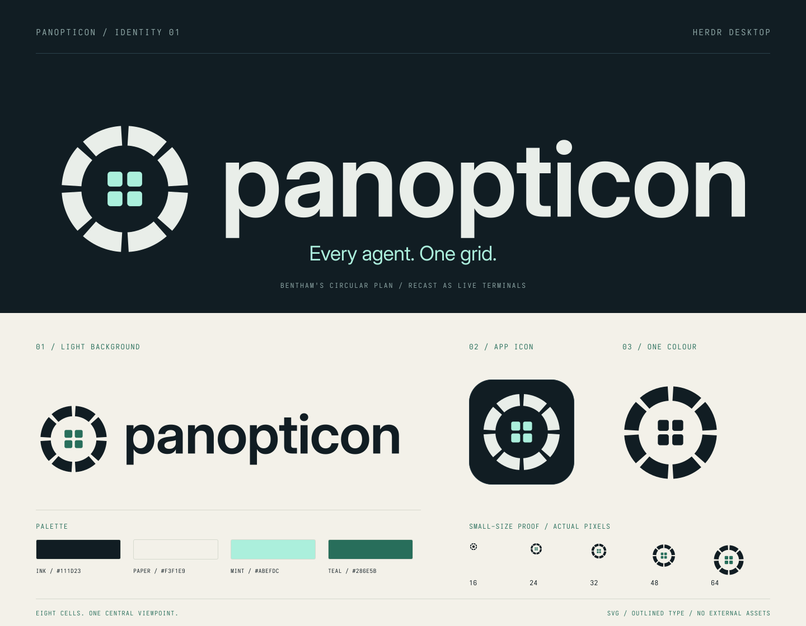

# Panopticon identity



## The idea

The name points to **Jeremy Bentham's Panopticon**: a circular arrangement of cells around a central inspection house. The mark takes that **floor-plan logic**, rather than using an eyeball, camera or prison bars.

- **Eight radial cells** make the surrounding sessions distinct but visible from one place.
- **Open radial gaps** suggest sightlines from the center to the whole perimeter.
- **Four central panes** turn the observation point into Panopticon's live terminal grid.
- The circular **o** forms in the lowercase wordmark echo the plan's geometry.

This is an abstraction, not a traced historical drawing or a claim that Bentham specified eight cells. Four panes are a recognizable grid, not a limit on the number of agents. The reference is spatial: one person working with their own visible agents, not hidden monitoring.

## Files

All exports live in [`media/brand/`](../media/brand/). SVGs have accessible titles/descriptions, transparent backgrounds unless noted, and **no external fonts, images or scripts**.

| Asset | Use |
| --- | --- |
| [`icon.svg`](../media/brand/icon.svg) | 256 × 256 master; ink and teal for a light background. |
| [`icon-dark.svg`](../media/brand/icon-dark.svg) | Chalk and mint for a dark background. |
| [`icon-mono.svg`](../media/brand/icon-mono.svg) | Single-color mark; `currentColor` when used inline. |
| [`logo.svg`](../media/brand/logo.svg) / [`logo-dark.svg`](../media/brand/logo-dark.svg) | 924 × 224 horizontal icon + outlined wordmark. |
| [`logo-mono.svg`](../media/brand/logo-mono.svg) | Single-color horizontal lockup. |
| [`logo.png`](../media/brand/logo.png) / [`logo-dark.png`](../media/brand/logo-dark.png) | Transparent 1848 × 448 exports for tools without SVG support. |
| [`app-icon.svg`](../media/brand/app-icon.svg) / [`app-icon.png`](../media/brand/app-icon.png) | 512 × 512 dark rounded tile for avatars and app artwork. |
| [`favicon.svg`](../media/brand/favicon.svg) / [`favicon.ico`](../media/brand/favicon.ico) | Optical small-size version; the ICO contains 16, 32 and 48 px images. |
| [`preview.svg`](../media/brand/preview.svg) / [`preview.png`](../media/brand/preview.png) | 1440 × 1120 identity/proof sheet. |

Use the full mark at **24 px and above**. The 16 px favicon deliberately widens the gaps and simplifies the center to a solid viewpoint, instead of shrinking four panes into noise. Leave clear space around the mark of roughly one terminal-pane width (one tenth of the icon's width). Do not fill the gaps, stretch the circle, or change the spacing between icon and wordmark.

`currentColor` inherits from the page only for an **inline SVG**. An SVG loaded through `` is its own document; use the supplied light/dark variants there, or explicitly recolor the monochrome file.

## Palette and type

| Color | Hex | Role |
| --- | --- | --- |
| Ink | `#111D23` | Primary foreground on light; app tile and dark field. |
| Paper | `#F3F1E9` | Warm drawing-paper background for the identity sheet. |
| Chalk | `#E9EEE9` | Foreground on dark. |
| Mint | `#ABEFDC` | Central panes on dark, matching the showcase's accent. |
| Teal | `#286E5B` | Deeper version of the accent for legibility on light. |

The wordmark is **Adwaita Sans 51**, weight 620, optical size 32, with adjusted tracking and optical vertical alignment. It is shaped with HarfBuzz and exported as paths with FontTools. The proof-sheet labels use Adwaita Mono. These are outlined uses of existing typefaces, not a new font. Adwaita is licensed under the **SIL Open Font License 1.1**; attribution and the license are preserved in [`FONT-LICENSE.txt`](FONT-LICENSE.txt). No font files are vendored.

## Inside the mod

The toolbar uses a **24 px native mark** beside the normal Panopticon title; the empty state uses a **48 px mark** above its message. The ring follows Herdr's `foreground`, and the four panes follow `accent` (falling back to `foreground` if no accent is available). The title keeps Herdr's UI font rather than shrinking the exported wordmark.

`brandMark()` in [`mods/panopticon/main.js`](../mods/panopticon/main.js) draws with GPUI's `PathBuilder` and `window.paint_path()`. The immutable, percentage-based paths are cached once per module and reused across sizes; colors are read anew on each render. No images, fonts, asset reads or redraw timers are added to the mod, and the installer still ships only `main.js` and `mod.json`.

## Rebuild and check

Inside the project's Nix shell (`nix develop`, or the existing direnv environment):

```sh
python branding/build.py
python branding/build.py --check
python -m unittest discover -s branding -p 'test_*.py'
```

The JSON-compatible `BRAND_GEOMETRY` block in `mods/panopticon/main.js` is the single geometry source for both the native mark and the exports. `build.py` reads that block as data, without executing the mod; it controls the export color variants, typography and proof sheet. It resolves the pinned Adwaita fonts through the shell's Fontconfig configuration. PNGs are rendered with librsvg; Pillow writes the lossless exports and multi-size ICO. `--out /path/to/directory` exports somewhere else. `--check` rebuilds in a temporary directory and compares the exports byte-for-byte without changing the checked-in assets.

`nix flake check` runs the export comparison and structural/raster tests alongside the mod's installer fixtures and shell lint. `bash tests/check.sh` also exercises the native mark through Herdr's own checker at both sizes, with dark/light colors and a missing-accent fallback. The assets are checked in, so consumers do not need Nix or a build step.

The root README follows the viewer's light/dark preference. The showcase source uses the new mark and favicon; re-render it to update the movie. Publishing a new GitHub video attachment remains a separate, manual step. **No branding files are installed with the mod**: the mark is native geometry in its existing entry file. The installer, session selection, grid geometry and controls are unchanged.
